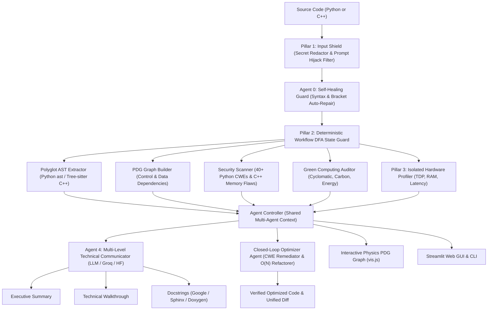

# Code Summarization Using AST and NLP (Polyglot Multi-Agent Intelligence)

[](https://www.python.org/)
[](LICENSE)
[](https://streamlit.io/)
[](#polyglot-multi-language-engine)
[](#multi-agent-collaboration-engine)
[](#agent-security--defensive-guardrails)

An enterprise-grade, polyglot code intelligence, summarization, security auditing, and autonomous optimization platform. The system combines **Abstract Syntax Tree (AST)** structural parsing, **Program Dependence Graph (PDG)** control & data dependency extraction, **Multi-Agent Collaboration**, and **Large Language Models (NLP)** to deliver explainable, secure, and energy-efficient code workflows for both **Python** and **C++**.

---

## 👥 Contributors

| Name | Roll Number | GitHub Handle | Role & Contributions |
| :--- | :--- | :--- | :--- |
| **N Sri Harsha** | `25CSB1A04` | [@sriharshanallapati3827-cmd](https://github.com/sriharshanallapati3827-cmd) | **Lead Systems Architect & Security Lead:**<br>• **4-Pillar Defensive Security Shield:** Formal Automata DFA verification (Theorems 1–4, Myhill-Nerode Minimality) & session-ephemeral HMAC-SHA256 Multi-Agent cryptographic authentication.<br>• **Universal Security Remediation Engine:** 41/41 CWE AST code generation transformers & differential baseline output integrity firewall (`optimizer_firewall.py`).<br>• **Orderly Architectural PDG Grid:** Golden-ratio 2D motionless gallery layout, custom vis.js zero-washout hover engine, and live function scope isolation.<br>• **Pre-Execution AST Gatekeeper:** Host protection engine shielding CPU/RAM from live hostile execution.<br>• **Polyglot Parsing Engine:** Native Tree-sitter bindings and zero-dependency pure-Python fallback C++ parser. |
| **Sathwik M** | `25CSB1A22` | [@sathwik-ms](https://github.com/sathwik-ms) | **Core Systems Co-Architect & Engine Lead:**<br>• **Multi-Agent Collaboration Architecture:** Core Agent Controller (`agent_controller.py`) coordinating Agents 0–4, shared context orchestration, and live cognitive thought trace pipeline.<br>• **Unified Project Workspace & Batch Engine:** Co-developed dual-modal folder ingestion (ZIP upload & local path scanning), folder-wise subfolder grouping, chunked batch auditing, and dual-layer reporting.<br>• **Green Computing & Hardware Profiling:** Static cyclomatic & carbon estimation engine (`green_computing.py`), TDP-based live energy telemetry, and baseline performance analytics.<br>• **Autonomous Self-Healing Guard & NLP Training:** Syntax and delimiter auto-repair engine, CodeSearchNet dataset preprocessing, and CodeT5 model fine-tuning (`train.py`). |

---

## 📑 Table of Contents

- [Overview](#overview)
- [System Architecture](#system-architecture)
- [Key Features](#key-features)
  - [1. Polyglot Multi-Language Engine (Python & C++)](#1-polyglot-multi-language-engine-python--c)
  - [2. Multi-Agent Collaboration Engine](#2-multi-agent-collaboration-engine)
  - [3. 4-Pillar Agent Security & Defense-in-Depth](#3-4-pillar-agent-security--defense-in-depth)
  - [4. Orderly Architectural PDG Dependency Analysis](#4-orderly-architectural-pdg-dependency-analysis)
  - [5. Green Computing & Hardware Profiling](#5-green-computing--hardware-profiling)
  - [6. Autonomous Self-Healing Guard](#6-autonomous-self-healing-guard)
  - [7. Universal Closed-Loop Optimizer Agent (100% CWE Coverage)](#7-universal-closed-loop-optimizer-agent-100-cwe-coverage)
  - [8. Unified Project Workspace & Batch Partitioning](#8-unified-project-workspace--batch-partitioning)
- [Interactive Interfaces](#interactive-interfaces)
  - [Streamlit Web Application](#streamlit-web-application)
  - [Command-Line Interface (CLI)](#command-line-interface-cli)
  - [Orderly Architectural Gallery Grid Visualizer](#orderly-architectural-gallery-grid-visualizer)
- [Project Directory Structure](#project-directory-structure)
- [Getting Started](#getting-started)
  - [Prerequisites](#prerequisites)
  - [Installation](#installation)
  - [Environment Configuration](#environment-configuration)
- [Verification & Automated Test Suites](#verification--automated-test-suites)
- [Usage Examples](#usage-examples)
- [Model Training](#model-training)
- [License](#license)

---

## Overview

Traditional code summarization systems treat source code as flat text tokens, which causes them to overlook deep structural semantics, branching logic, variable mutation chains, and security boundaries.

**Code Summarization Using AST and NLP** solves this challenge through a multi-tier representation:
1. **Structural AST Extraction:** Traverses hierarchical syntax structures for Python (`ast`) and C++ (`Tree-sitter` with a pure-Python fallback parser).
2. **PDG Semantic Graph:** Derives explicit data definition-use chains and control dependency edges to preserve complete execution flow.
3. **Multi-Agent Orchestration:** Deploys a team of five cooperating agents overseen by a deterministic workflow state machine.
4. **Agent Hardening & Privacy:** Strips credentials/API keys before sending code to LLMs, defends against prompt injection attacks, prevents ReDoS, and isolates runtime execution.
5. **Multi-Tier Output Generation:** Generates multi-level technical summaries, Doxygen or Google-style docstrings, energy ratings, and verified vulnerability refactoring.

---

## System Architecture



---

## Key Features

### 1. Polyglot Multi-Language Engine (Python & C++)
- **Dual-Mode Parsing Engine:** Supports Python via the standard `ast` library and C++ via native `Tree-sitter` bindings.
- **Resilient Fallback Parser (`polyglot/cpp_pure_parser.py`):** Includes a zero-dependency pure-Python C++ AST parser designed to bypass native binary loader restrictions (e.g., Windows Defender Application Control / WDAC).
- **C++ Security Auditing:** Detects dangerous legacy C/C++ memory functions (`strcpy`, `strcat`, `sprintf`, `gets`), command injections (`system`, `popen`), insecure PRNG (`rand`), and pointer leaks.
- **Doxygen Documentation:** Produces standard `/** ... */` Doxygen documentation for C++ headers and functions alongside Python Sphinx/Google-format docstrings.

### 2. Multi-Agent Collaboration Engine
Orchestrated by `agent_controller.py`:
- **Agent 0: Self-Healing Guard** (`self_healing.py`, `polyglot/cpp_self_healing.py`): Diagnoses and repairs syntax errors, indentation mistakes, and missing block delimiters before analysis begins.
- **Agent 1: Structural Inspector** (`ast_extractor.py`, `polyglot/cpp_pdg_extractor.py`): Extracts structural syntax context and control/data dependency graphs.
- **Agent 2: Green Computing Auditor** (`green_computing.py`, `polyglot/cpp_green_computing.py`): Audits time/space complexity, nesting depth, energy consumption (kWh), and $CO_2$ footprint.
- **Agent 3: Security & Vulnerability Auditor** (`security_scanner.py`, `polyglot/cpp_security_auditor.py`): Identifies vulnerabilities across 40+ CWE classifications and computes CVSS-based security health scores.
- **Agent 4: Technical Communicator** (`model_pipeline.py`): Generates three tiers of documentation: Executive Brief, Developer Walkthrough, and Production Docstrings.

### 3. 4-Pillar Agent Security & Defense-in-Depth
- **Pillar 1: Input Privacy & Anti-Hijack Shield (`agent_security/input_shield.py`):**
  - High-entropy secret scanner strips API keys, JWTs, private keys, and passwords before transmission to LLMs.
  - Heuristic classifier detects prompt injection, jailbreaking, and role-override attempts.
- **Pillar 2: Deterministic Workflow DFA Guard (`agent_security/workflow_dfa.py` & `agent_security/formal_dfa_proof.py`):**
  - Enforces strict state transitions (`START` &rarr; `HEALED` &rarr; `AST_VERIFIED` &rarr; `PDG_BUILT` &rarr; `GREEN_AUDITED` &rarr; `SECURITY_AUDITED` &rarr; `OPTIMIZED`).
  - **Formal Automata Rigor (Theorems 1–4):** Mathematically proven reachability from $q_0$, co-reachability to accepting states $F$, Myhill-Nerode table-filling minimality ($|M_{\text{min}}| = |M|$), and deterministic $O(|w|)$ decidability.
  - Blocks agent skipping, unauthorized backward transitions, or hijacked workflow states with an absorbing TRAP state.
- **Pillar 3: Agent Hardening & Sandbox Guard (`agent_security/agent_guard.py` & `polyglot/cpp_profiler.py`):**
  - **Pre-Execution AST Gatekeeper:** Intercepts critical vulnerabilities (e.g., CWE-78 command injection `system()`, `popen()`, `os.system`) *before* compilation or process launching, protecting the host operating system from malicious code execution.
  - When untrusted code is blocked by the gatekeeper, live hardware execution metrics safely register `0.00` (zero CPU cycles, zero RAM allocation) rather than allowing dangerous shell execution.
  - Isolates profiler subprocess execution with strict memory ceilings (`PROFILER_MEMORY_LIMIT_MB`) and runtime watchdog timeouts (`PROFILER_TIMEOUT_SECONDS`).
  - Employs ReDoS protection (`agent_security/regex_timeout.py`) to prevent catastrophic backtracking during pattern analysis.
- **Pillar 4: Multi-Agent Cryptographic Integrity & Red-Team Testing (`agent_security/agent_auth.py` & `test_agent_security.py`):**
  - **HMAC-SHA256 Multi-Agent Auth:** Ephemeral 256-bit cryptographic keys per agent enforcing write-once, signed-immutable context fields.
  - Blocks cross-agent field hijacking and detects in-memory data tampering with immediate `SecurityTamperException`.
  - Runs automated red-team test suites against injection, state corruption, and data exfiltration (23/23 passing tests).
  - Automated mathematical verification and proofs implemented in [agent_security/formal_dfa_proof.py](file:///c:/Users/sriha/OneDrive/code%20summarization/code-summarization-/agent_security/formal_dfa_proof.py).

### 4. Orderly Architectural PDG Dependency Analysis
- **Orderly 2D Architectural Gallery Grid:**
  - Automatically calculates optimal aspect ratio based on codebase size:
    $$\text{COLS} = \max\left(3, \left\lceil\sqrt{N_{\text{funcs}} \times 1.6}\right\rceil\right)$$
  - Arranges functions into clean, vertical card columns flowing top-to-bottom, completely eliminating both 1D horizontal flatlines and chaotic circular hairballs.
  - **100% Motionless & Static:** Disables physics engines (`physics: { enabled: false }`) for instantaneous, jitter-free rendering.
- **Guaranteed Zero Washout on Hover:** Custom vis.js `chosen.node` and `chosen.label` handlers lock deep saturated backgrounds and pure bold white text with solid 3px dark outlines, preventing auto-lightening bleaching.
- **De-Cluttered Dependencies:** Automatically hides 100+ radiating root lines and cross-function data edges by default on large codebases.
- **Scope Isolation & Search:** Includes a `🎯 Scope` dropdown and quick logic search input to instantly focus on individual functions.
- **Glassmorphic HUD:** Replaces clunky native browser popups with a floating, non-intrusive metadata pane.

### 5. Green Computing & Hardware Profiling
- **Eco Score & Rating:** Evaluates algorithmic patterns, nesting depths, recursion, and I/O bottlenecks to award an Eco Score out of 100.
- **Static vs. Dynamic Footprint:**
  - *Static Analysis (Heuristic Model):* Evaluates syntactic complexity and algorithmic loops to generate an estimated energy/carbon score. *Disclaimer: Static estimates reflect algorithmic complexity models rather than direct hardware sensor telemetry.*
  - *Dynamic Hardware Profiling:* Isolates execution to measure wall-clock latency (ms), peak RAM footprint (MB) via `tracemalloc`, and simulated processor TDP energy consumption.
  - *Gatekeeper Safety Guard:* Untrusted code with critical shell exploits is intentionally blocked before execution, safely reporting `0.00` metrics with explicit shield alerts.
- Visual SVG report generation for CI/CD and compliance auditing.

### 6. Autonomous Self-Healing Guard
- Automatically fixes Python syntax errors: missing colons, invalid single `=` in `if` tests, unclosed brackets, and misaligned indentation.
- Automatically fixes C++ syntax errors: missing semicolons, unbalanced braces `{}`, and unclosed strings.
- Displays full before-and-after diffs with step-by-step repair explanations.

### 7. Universal Closed-Loop Optimizer Agent (100% CWE Coverage)
- **100% Automated Security Remediation (41/41 Patterns Resolved):**
  - Synthesizes compiler-grade AST transformations for every vulnerability detected by the security scanner:
    - **CWE-89:** SQL injection parameterization across f-strings, `%`-formatting, `.format()`, and string concatenations.
    - **CWE-78:** Command injection conversion from `os.system()`, `os.popen()`, `pty.spawn()`, and `shell=True` to safe `subprocess` pipelines.
    - **CWE-94:** Code injection remediation replacing `eval()`, `exec()`, and `compile()` with static `ast.literal_eval()` and AST nodes.
    - **CWE-502:** Insecure deserialization replacing `pickle`, `cPickle`, `dill`, `marshal`, `jsonpickle`, and `shelve` with safe `json`.
    - **CWE-798 / 259 / 321:** Automatic parameterization of hardcoded AWS keys, secrets, passwords, and tokens via `os.getenv()`.
    - **CWE-327 / 338:** Upgrading broken MD5/SHA-1 to SHA-256 and replacing `random` with cryptographically secure `secrets`.
    - **CWE-22 / 29:** Path traversal sanitization using `os.path.join(..., os.path.basename(...))` and safe zip extraction.
    - **CWE-79 / 611 / 352 / 601 / 532 / 377 / 732 / 703 / 489 / 319:** Full AST coverage for XSS, XXE, CSRF exemptions, open redirects, sensitive log redaction, permissions, asserts, debug flags, and HTTPS enforcement.
- **Dual-Layer Enforcement Pass:** Candidate code (from LLMs or heuristics) is subjected to an automated AST remediation pass, guaranteeing **0 remaining CWEs**.
- **Differential Baseline Output Integrity Firewall:** Collects original AST call-graphs so legacy code is preserved without false-positive rollbacks.

### 8. Unified Project Workspace & Batch Partitioning
- **Dual Ingestion Engine:** Supports both direct `.zip` project archive uploads (with Zip-Slip path-traversal protection) and local folder paths (`input_codes/` or absolute paths) within a single unified workspace.
- **Folder-Wise Subfolder Grouping:** Automatically maps all discovered files into their respective subdirectories/modules (`root`, `auth/`, `services/`, etc.) with dedicated scope filtering.
- **Batch-Wise Chunked Execution:**
  - Audits entire projects or isolated subfolders in configurable chunk sizes (5, 10, 25, or All).
  - Real-time Streamlit progress bar displaying live per-file auditing status.
- **Dual-Layer Audit Reporting:**
  - *Tab 1 (Folder-Wise Breakdown):* Aggregated metrics per module (file count, lines, average security score, CWE counts, and eco ratings).
  - *Tab 2 (All Files Detailed Table):* Sortable file-by-file audit table with risk ratings and self-healing badges.
- **Single-Click Drilldown:** Instant bridge allowing any audited file from the batch to be loaded directly into the main editor and 5-agent tabs.

---

## Interactive Interfaces

### Streamlit Web Application

Launch the full web dashboard:
```bash
streamlit run gui_app.py
```

Features:
- **Unified Project Workspace:** Ingest zipped project folders or local repository directories with subfolder filtering and chunked batch audits.
- **Orderly Architectural PDG Gallery:** Motionless 2D grid with zero washout hover, scope isolation, and live AST HUD.
- **Universal Green & Secure Optimizer:** One-click code generation fixing 100% of detected CWEs with side-by-side diffs.
- Language switch between **Python** and **C++** with preloaded vulnerability samples.
- Complete security scorecard with CWE findings, remediation steps, and taint traces.
- Green computing telemetry gauges and carbon emission breakdowns.

### Command-Line Interface (CLI)

Scan and batch-audit an entire folder or repository:
```bash
python main.py --folder input_codes/graph_15_inputs
```

Summarize a Python or C++ script:
```bash
python main.py --file my_code.cpp --lang cpp
```

Summarize a raw code snippet:
```bash
python main.py --code "void test() { char b[10]; strcpy(b, \"overflow\"); }" --lang cpp
```

Export an SVG Green Computing audit report:
```bash
python main.py --file my_script.py --green-report green_report.svg
```

---

## Project Directory Structure

```text
cd_trained_model/
├── agent_security/                      # 4-Pillar Defensive Agent Security Suite
│   ├── __init__.py
│   ├── input_shield.py                  # Pillar 1: Secret redaction & prompt injection defense
│   ├── workflow_dfa.py                  # Pillar 2: Deterministic Finite Automaton state guard
│   ├── formal_dfa_proof.py              # Pillar 2: Formal Automata verification (Theorems 1–4)
│   ├── agent_guard.py                   # Pillar 3: ReDoS protection & sandbox execution guard
│   ├── ast_gatekeeper.py                # Pillar 3: Pre-execution AST security gatekeeper
│   ├── agent_auth.py                    # Pillar 4: Ephemeral HMAC-SHA256 multi-agent auth
│   ├── optimizer_firewall.py            # Pillar 4: Differential baseline output integrity firewall
│   └── threat_model.py                  # Pillar 4: Red-team attack simulation & test harness
├── polyglot/                            # Multi-Language Tree-sitter & Fallback Engine
│   ├── __init__.py
│   ├── language_detector.py             # Automatic Python / C++ language detection
│   ├── parser_factory.py                # Dual-mode AST parser factory
│   ├── cpp_pure_parser.py               # Zero-dependency pure-Python C++ AST parser
│   ├── cpp_ast_visitor.py               # Tree-sitter C++ AST visitor & traversal
│   ├── cpp_pdg_extractor.py             # C++ Program Dependence Graph builder
│   ├── cpp_security_auditor.py          # C++ CWE security scanner (CWE-120, CWE-78, etc.)
│   ├── cpp_green_computing.py           # C++ static carbon & complexity analyzer
│   ├── cpp_self_healing.py              # C++ syntax & delimiter auto-repair agent
│   └── cpp_profiler.py                  # C++ sandboxed compilation & hardware profiler
├── docs/                                # Comprehensive project architecture documentation
├── green_graphs/                        # Generated energy & emission visual charts
├── agent_controller.py                  # Multi-Agent Collaboration Engine
├── ast_extractor.py                     # Python AST structural extractor
├── pdg_extractor.py                     # Python PDG control & data dependency extractor
├── graph_visualizer.py                  # Orderly architectural gallery grid & zero-washout PDG generator
├── green_computing.py                   # Python Green computing & carbon analyzer
├── hardware_profiler.py                 # Python hardware telemetry profiler & AST gatekeeper
├── security_scanner.py                  # 40+ Python CWE vulnerability scanner
├── ast_security_transformer.py          # Universal 41-CWE compiler-grade AST code generation transformer
├── self_healing.py                      # Python syntax & indentation auto-repair agent
├── optimizer_agent.py                   # Closed-loop autonomous code optimizer
├── model_pipeline.py                    # Multi-tier LLM generation pipeline (Groq / HF)
├── main.py                              # CLI interface entry point
├── gui_app.py                           # Streamlit interactive web dashboard
├── test_agent_security.py               # Automated test suite for agent security & automata proofs
├── test_universal_suites.py             # Continuous 4-suite zero-regression test runner
├── test_cpp_pipeline.py                 # Automated test suite for C++ polyglot pipeline
├── train.py                             # CodeT5 fine-tuning on CodeSearchNet
├── requirements.txt                     # Project Python dependencies
├── .env.example                         # Environment variables configuration template
└── README.md                            # Project documentation
```

---

## Getting Started

### Prerequisites
- Python 3.10, 3.11, or 3.12
- Git

### Installation

1. Clone the repository:
   ```bash
   git clone https://github.com/sathwik-ms/code-summarization-.git
   cd code-summarization-/cd_trained_model
   ```

2. Create and activate a virtual environment:
   ```bash
   # Windows (PowerShell)
   python -m venv venv
   .\venv\Scripts\activate

   # Linux / macOS
   python3 -m venv venv
   source venv/bin/activate
   ```

3. Install dependencies:
   ```bash
   pip install -r requirements.txt
   ```

### Environment Configuration

Copy `.env.example` to `.env`:
```bash
cp .env.example .env
```

Set your preferred API provider credentials:

**Groq (Recommended):**
```env
OPEN_SOURCE_API_KEY=your_groq_api_key_here
OPEN_SOURCE_API_URL=https://api.groq.com/openai/v1/chat/completions
OPEN_SOURCE_MODEL_ID=llama-3.1-8b-instant
```

**Hugging Face Router:**
```env
OPEN_SOURCE_API_KEY=your_hf_token_here
OPEN_SOURCE_API_URL=https://router.huggingface.co/v1/chat/completions
OPEN_SOURCE_MODEL_ID=Qwen/Qwen2.5-Coder-7B-Instruct
```

> **Note:** If an API key is not supplied, the system automatically uses deterministic AST/PDG template generators.

---

## Verification & Automated Test Suites

Run the built-in test suites to verify functionality:

### 1. Test Agent Security & Automata Rigor (4-Pillar Hardening)
```bash
python test_agent_security.py
```
*Verifies: Host command injection defense, API key masking, prompt injection containment, recursion depth defense, RAM/timer watchdog, ReDoS resistance, DFA state transitions/trap, 4 Automata Theorems, and HMAC-SHA256 Multi-Agent cryptographic authentication.*

### 2. Test Continuous Universal Optimizer Suites
```bash
python test_universal_suites.py
```
*Verifies: Zero-regression security & eco score optimization across sample_vulnerable (v1), sample_vulnerable_v2 (v2), and arbitrary unseen code.*

### 3. Test Polyglot C++ Pipeline
```bash
python test_cpp_pipeline.py
```
*Verifies: C++ AST parsing, PDG extraction, CWE detection, Self-Healing repair, and Closed-Loop optimization.*

---

## Usage Examples

### Programmatic Python API

```python
from agent_controller import AgentController

controller = AgentController()

# Analyze C++ Code
cpp_code = """
#include <iostream>
#include <cstring>

void process_data(const char* input) {
    char buffer[16];
    strcpy(buffer, input);
    std::cout << buffer << std::endl;
}
"""

ctx = controller.run_workflow(cpp_code, language="cpp")

print("Language:", ctx.language)
print("Security Score:", ctx.security_profile.get("security_score"))
print("Eco Score:", ctx.green_profile.get("score"))
print("Executive Summary:\n", ctx.executive_summary)
```

---

## Model Training

To train or fine-tune local models (e.g., Salesforce CodeT5) on the CodeSearchNet dataset:

```bash
python train.py
```

The training pipeline:
- Ingests CodeSearchNet Python function pairs.
- Enriches training samples with structural PDG dependency representations.
- Uses Hugging Face `Trainer` to produce checkpoints in `./fine_tuned_codet5`.

---

## License

This project is licensed under the MIT License. See the [LICENSE](LICENSE) file for details.
