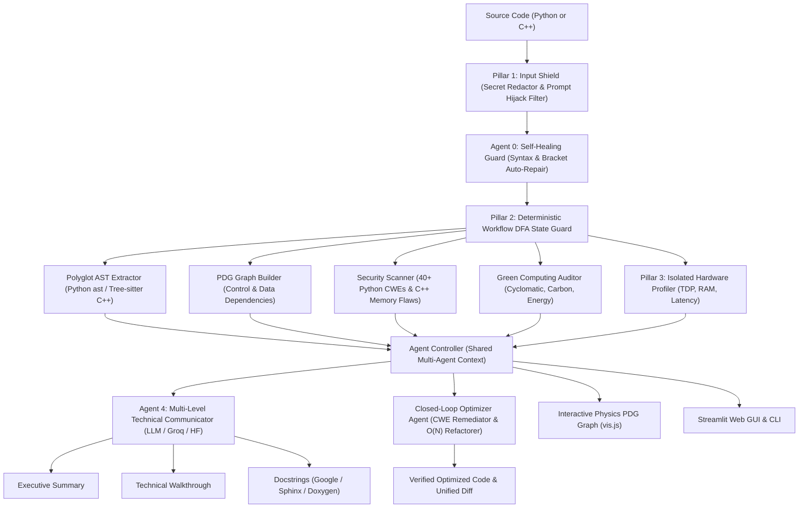

# Code Summarization Using AST and NLP (Polyglot Multi-Agent Intelligence)

[](https://www.python.org/)
[](LICENSE)
[](https://streamlit.io/)
[](#polyglot-multi-language-engine)
[](#multi-agent-collaboration-engine)
[](#agent-security--defensive-guardrails)

An enterprise-grade, polyglot code intelligence, summarization, security auditing, and autonomous optimization platform. The system combines **Abstract Syntax Tree (AST)** structural parsing, **Program Dependence Graph (PDG)** control & data dependency extraction, **Multi-Agent Collaboration**, and **Large Language Models (NLP)** to deliver explainable, secure, and energy-efficient code workflows for both **Python** and **C++**.

---

## 👥 Contributors

| Name | Roll Number | GitHub Handle | Role |
| :--- | :--- | :--- | :--- |
| **Sathwik M** | `25CSB1A22` | [@sathwik-ms](https://github.com/sathwik-ms) | Project Architect, Core Multi-Agent Controller, AST/PDG Engine, Optimization Agent |
| **N Sri Harsha** | `25CSB1A04` | [@sriharshanallapati3827-cmd](https://github.com/sriharshanallapati3827-cmd) | Polyglot Tree-sitter Pipeline, 4-Pillar Agent Security Shield, UI/UX Systems |

---

## 📑 Table of Contents

- [Overview](#overview)
- [System Architecture](#system-architecture)
- [Key Features](#key-features)
  - [1. Polyglot Multi-Language Engine (Python & C++)](#1-polyglot-multi-language-engine-python--c)
  - [2. Multi-Agent Collaboration Engine](#2-multi-agent-collaboration-engine)
  - [3. 4-Pillar Agent Security & Defense-in-Depth](#3-4-pillar-agent-security--defense-in-depth)
  - [4. AST & PDG Dependency Analysis](#4-ast--pdg-dependency-analysis)
  - [5. Green Computing & Hardware Profiling](#5-green-computing--hardware-profiling)
  - [6. Autonomous Self-Healing Guard](#6-autonomous-self-healing-guard)
  - [7. Closed-Loop Optimizer Agent](#7-closed-loop-optimizer-agent)
- [Interactive Interfaces](#interactive-interfaces)
  - [Streamlit Web Application](#streamlit-web-application)
  - [Command-Line Interface (CLI)](#command-line-interface-cli)
  - [Interactive Physics-Based PDG Graph](#interactive-physics-based-pdg-graph)
- [Project Directory Structure](#project-directory-structure)
- [Getting Started](#getting-started)
  - [Prerequisites](#prerequisites)
  - [Installation](#installation)
  - [Environment Configuration](#environment-configuration)
- [Verification & Automated Test Suites](#verification--automated-test-suites)
- [Usage Examples](#usage-examples)
- [Model Training](#model-training)
- [License](#license)

---

## Overview

Traditional code summarization systems treat source code as flat text tokens, which causes them to overlook deep structural semantics, branching logic, variable mutation chains, and security boundaries.

**Code Summarization Using AST and NLP** solves this challenge through a multi-tier representation:
1. **Structural AST Extraction:** Traverses hierarchical syntax structures for Python (`ast`) and C++ (`Tree-sitter` with a pure-Python fallback parser).
2. **PDG Semantic Graph:** Derives explicit data definition-use chains and control dependency edges to preserve complete execution flow.
3. **Multi-Agent Orchestration:** Deploys a team of five cooperating agents overseen by a deterministic workflow state machine.
4. **Agent Hardening & Privacy:** Strips credentials/API keys before sending code to LLMs, defends against prompt injection attacks, prevents ReDoS, and isolates runtime execution.
5. **Multi-Tier Output Generation:** Generates multi-level technical summaries, Doxygen or Google-style docstrings, energy ratings, and verified vulnerability refactoring.

---

## System Architecture



---

## Key Features

### 1. Polyglot Multi-Language Engine (Python & C++)
- **Dual-Mode Parsing Engine:** Supports Python via the standard `ast` library and C++ via native `Tree-sitter` bindings.
- **Resilient Fallback Parser (`polyglot/cpp_pure_parser.py`):** Includes a zero-dependency pure-Python C++ AST parser designed to bypass native binary loader restrictions (e.g., Windows Defender Application Control / WDAC).
- **C++ Security Auditing:** Detects dangerous legacy C/C++ memory functions (`strcpy`, `strcat`, `sprintf`, `gets`), command injections (`system`, `popen`), insecure PRNG (`rand`), and pointer leaks.
- **Doxygen Documentation:** Produces standard `/** ... */` Doxygen documentation for C++ headers and functions alongside Python Sphinx/Google-format docstrings.

### 2. Multi-Agent Collaboration Engine
Orchestrated by `agent_controller.py`:
- **Agent 0: Self-Healing Guard** (`self_healing.py`, `polyglot/cpp_self_healing.py`): Diagnoses and repairs syntax errors, indentation mistakes, and missing block delimiters before analysis begins.
- **Agent 1: Structural Inspector** (`ast_extractor.py`, `polyglot/cpp_pdg_extractor.py`): Extracts structural syntax context and control/data dependency graphs.
- **Agent 2: Green Computing Auditor** (`green_computing.py`, `polyglot/cpp_green_computing.py`): Audits time/space complexity, nesting depth, energy consumption (kWh), and $CO_2$ footprint.
- **Agent 3: Security & Vulnerability Auditor** (`security_scanner.py`, `polyglot/cpp_security_auditor.py`): Identifies vulnerabilities across 40+ CWE classifications and computes CVSS-based security health scores.
- **Agent 4: Technical Communicator** (`model_pipeline.py`): Generates three tiers of documentation: Executive Brief, Developer Walkthrough, and Production Docstrings.

### 3. 4-Pillar Agent Security & Defense-in-Depth
- **Pillar 1: Input Privacy & Anti-Hijack Shield (`agent_security/input_shield.py`):**
  - High-entropy secret scanner strips API keys, JWTs, private keys, and passwords before transmission to LLMs.
  - Heuristic classifier detects prompt injection, jailbreaking, and role-override attempts.
- **Pillar 2: Deterministic Workflow DFA Guard (`agent_security/workflow_dfa.py`):**
  - Enforces strict state transitions (`RAW_INPUT` &rarr; `HEALED` &rarr; `PARSED` &rarr; `ANALYZED` &rarr; `SUMMARIZED` &rarr; `OPTIMIZED`).
  - Blocks agent skipping, unauthorized backward transitions, or hijacked workflow states.
- **Pillar 3: Agent Hardening & Sandbox Guard (`agent_security/agent_guard.py`):**
  - Isolates profiler subprocess execution with strict memory and runtime timeouts.
  - Employs ReDoS protection to prevent catastrophic backtracking during regex analysis.
- **Pillar 4: Threat Model Verification (`agent_security/threat_model.py`):**
  - Runs automated red-team test suites against injection, state corruption, and data exfiltration.

### 4. AST & PDG Dependency Analysis
- **Program Dependence Graph (PDG):**
  - Control dependency edges (branch conditions, loops, exception handlers).
  - Data dependency edges (definition-use chains, variable mutations).
- **Interactive Visualization:** Uses **vis.js** with physics-based nodes and color-coded edge semantics for exploring relationships.

### 5. Green Computing & Hardware Profiling
- **Eco Score & Rating:** Evaluates algorithmic patterns, nesting depths, recursion, and I/O bottlenecks to award an Eco Score out of 100.
- **Static vs. Dynamic Footprint:** Measures wall-clock execution time (ms), peak RAM (MB) using `tracemalloc`, hardware TDP energy (kWh), and estimated $CO_2e$ emissions.
- Visual SVG report generation for CI/CD and compliance auditing.

### 6. Autonomous Self-Healing Guard
- Automatically fixes Python syntax errors: missing colons, invalid single `=` in `if` tests, unclosed brackets, and misaligned indentation.
- Automatically fixes C++ syntax errors: missing semicolons, unbalanced braces `{}`, and unclosed strings.
- Displays full before-and-after diffs with step-by-step repair explanations.

### 7. Closed-Loop Optimizer Agent
- Refactors inefficient patterns (e.g., replaces nested $O(N^2)$ loops with lookups or generator expressions).
- Remediates detected CWEs (e.g., replaces `strcpy` with bounds-checked `strncpy`, replaces `system()` with secure audit logging, replaces `eval()` with AST literals).
- Performs automated zero-regression verification to confirm the new code parses cleanly, improves the security score, and maintains functionality.

---

## Interactive Interfaces

### Streamlit Web Application

Launch the full web dashboard:
```bash
streamlit run gui_app.py
```

Features:
- **Flexible Input Modes:** Choose from Benchmark Presets, Upload Single/Multiple Files, or scan an **Entire Folder / Directory Path**.
- **Batch Folder Audit:** Scan an entire codebase directory to produce project-wide security scorecards, aggregate carbon impact, and interactive breakdown tables.
- Language switch between **Python** and **C++** with preloaded vulnerability samples.
- Live physics-driven PDG dependency explorer.
- Complete security scorecard with CWE findings, remediation steps, and taint traces.
- Green computing telemetry gauges and carbon emission breakdowns.
- Side-by-side optimization diff viewer.

### Command-Line Interface (CLI)

Scan and batch-audit an entire folder or repository:
```bash
python main.py --folder input_codes/graph_15_inputs
```

Summarize a Python or C++ script:
```bash
python main.py --file my_code.cpp --lang cpp
```

Summarize a raw code snippet:
```bash
python main.py --code "void test() { char b[10]; strcpy(b, \"overflow\"); }" --lang cpp
```

Export an SVG Green Computing audit report:
```bash
python main.py --file my_script.py --green-report green_report.svg
```

---

## Project Directory Structure

```text
cd_trained_model/
├── agent_security/                      # 4-Pillar Defensive Agent Security Suite
│   ├── __init__.py
│   ├── input_shield.py                  # Pillar 1: Secret redaction & prompt injection defense
│   ├── workflow_dfa.py                  # Pillar 2: Deterministic Finite Automaton state guard
│   ├── agent_guard.py                   # Pillar 3: ReDoS protection & sandbox execution guard
│   └── threat_model.py                  # Pillar 4: Red-team attack simulation & test harness
├── polyglot/                            # Multi-Language Tree-sitter & Fallback Engine
│   ├── __init__.py
│   ├── language_detector.py             # Automatic Python / C++ language detection
│   ├── parser_factory.py                # Dual-mode AST parser factory
│   ├── cpp_pure_parser.py               # Zero-dependency pure-Python C++ AST parser
│   ├── cpp_ast_visitor.py               # Tree-sitter C++ AST visitor & traversal
│   ├── cpp_pdg_extractor.py             # C++ Program Dependence Graph builder
│   ├── cpp_security_auditor.py          # C++ CWE security scanner (CWE-120, CWE-78, etc.)
│   ├── cpp_green_computing.py           # C++ static carbon & complexity analyzer
│   ├── cpp_self_healing.py              # C++ syntax & delimiter auto-repair agent
│   └── cpp_profiler.py                  # C++ sandboxed compilation & hardware profiler
├── docs/                                # Comprehensive project architecture documentation
├── green_graphs/                        # Generated energy & emission visual charts
├── agent_controller.py                  # Multi-Agent Collaboration Engine
├── ast_extractor.py                     # Python AST structural extractor
├── pdg_extractor.py                     # Python PDG control & data dependency extractor
├── graph_visualizer.py                  # Physics-based vis.js network generator
├── green_computing.py                   # Python Green computing & carbon analyzer
├── hardware_profiler.py                 # Python hardware telemetry profiler
├── security_scanner.py                  # 40+ Python CWE vulnerability scanner
├── self_healing.py                      # Python syntax & indentation auto-repair agent
├── optimizer_agent.py                   # Closed-loop autonomous code optimizer
├── model_pipeline.py                    # Multi-tier LLM generation pipeline (Groq / HF)
├── main.py                              # CLI interface entry point
├── gui_app.py                           # Streamlit interactive web dashboard
├── test_agent_security.py               # Automated test suite for agent security
├── test_cpp_pipeline.py                 # Automated test suite for C++ polyglot pipeline
├── train.py                             # CodeT5 fine-tuning on CodeSearchNet
├── requirements.txt                     # Project Python dependencies
├── .env.example                         # Environment variables configuration template
└── README.md                            # Project documentation
```

---

## Getting Started

### Prerequisites
- Python 3.10, 3.11, or 3.12
- Git

### Installation

1. Clone the repository:
   ```bash
   git clone https://github.com/sathwik-ms/code-summarization-.git
   cd code-summarization-/cd_trained_model
   ```

2. Create and activate a virtual environment:
   ```bash
   # Windows (PowerShell)
   python -m venv venv
   .\venv\Scripts\activate

   # Linux / macOS
   python3 -m venv venv
   source venv/bin/activate
   ```

3. Install dependencies:
   ```bash
   pip install -r requirements.txt
   ```

### Environment Configuration

Copy `.env.example` to `.env`:
```bash
cp .env.example .env
```

Set your preferred API provider credentials:

**Groq (Recommended):**
```env
OPEN_SOURCE_API_KEY=your_groq_api_key_here
OPEN_SOURCE_API_URL=https://api.groq.com/openai/v1/chat/completions
OPEN_SOURCE_MODEL_ID=llama-3.1-8b-instant
```

**Hugging Face Router:**
```env
OPEN_SOURCE_API_KEY=your_hf_token_here
OPEN_SOURCE_API_URL=https://router.huggingface.co/v1/chat/completions
OPEN_SOURCE_MODEL_ID=Qwen/Qwen2.5-Coder-7B-Instruct
```

> **Note:** If an API key is not supplied, the system automatically uses deterministic AST/PDG template generators.

---

## Verification & Automated Test Suites

Run the built-in test suites to verify functionality:

### 1. Test Agent Security (4-Pillar Hardening)
```bash
python test_agent_security.py
```
*Verifies: API key masking, prompt injection defense, DFA state integrity, and ReDoS resistance.*

### 2. Test Polyglot C++ Pipeline
```bash
python test_cpp_pipeline.py
```
*Verifies: C++ AST parsing, PDG extraction, CWE detection, Self-Healing repair, and Closed-Loop optimization.*

---

## Usage Examples

### Programmatic Python API

```python
from agent_controller import AgentController

controller = AgentController()

# Analyze C++ Code
cpp_code = """
#include <iostream>
#include <cstring>

void process_data(const char* input) {
    char buffer[16];
    strcpy(buffer, input);
    std::cout << buffer << std::endl;
}
"""

ctx = controller.run_workflow(cpp_code, language="cpp")

print("Language:", ctx.language)
print("Security Score:", ctx.security_profile.get("security_score"))
print("Eco Score:", ctx.green_profile.get("score"))
print("Executive Summary:\n", ctx.executive_summary)
```

---

## Model Training

To train or fine-tune local models (e.g., Salesforce CodeT5) on the CodeSearchNet dataset:

```bash
python train.py
```

The training pipeline:
- Ingests CodeSearchNet Python function pairs.
- Enriches training samples with structural PDG dependency representations.
- Uses Hugging Face `Trainer` to produce checkpoints in `./fine_tuned_codet5`.

---

## License

This project is licensed under the MIT License. See the [LICENSE](LICENSE) file for details.
